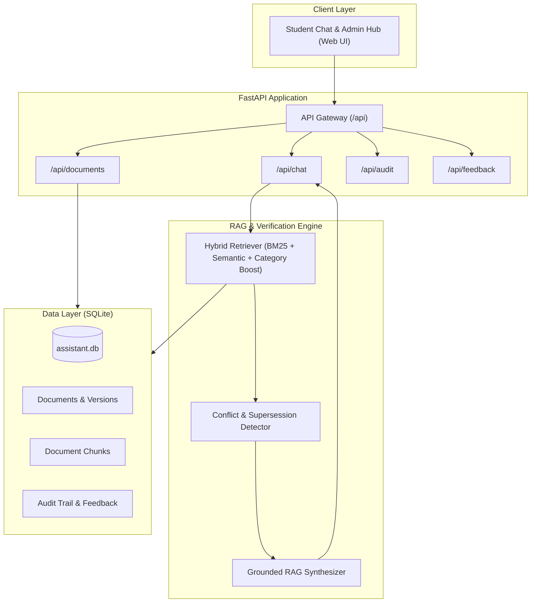

# Hostel & Transport Rules Assistant 🎓🚌

> **Evidence-Grounded RAG & Policy Verification System for College Hostel Operations and Campus Transport.**

[](./tests)
[](https://www.python.org/)
[](https://fastapi.tiangolo.com/)
[](LICENSE)

---

## 📌 Overview

Students regularly navigate complex, fragmented institutional policies: curfew and roll-call timings, outstation leave permissions, late-entry penalties, bus routes, morning pickup stops, and transit schedules. Conventional chatbots frequently hallucinate dates and procedures, while manual search across PDFs and notice boards is error-prone.

The **Hostel & Transport Rules Assistant** is a specialized, document-grounded question-answering platform powered by **Retrieval-Augmented Generation (RAG)**. Every answer is strictly extracted from approved institutional documents, complete with **exact document titles, publication dates, effective dates, page numbers, and freshness warnings**.

---

## ✨ Key Capabilities

* 🎯 **Strict Document Grounding:** Every statement directly cites an approved institutional source. The assistant never invents timings, route numbers, or policies.
* 📅 **Date & Freshness Awareness:** Distinguishes between *publication date* and *effective date*. Automatically warns students when citing older or undated circulars.
* ⚠️ **Supersession & Conflict Handling:** When newer notices revise older rules (e.g., Circular No. 14/2026 extending weekend curfew), the system detects the relationship, prioritizes the newer rule, and flags superseded sources.
* 🛑 **Hallucination Prevention & Abstention:** Deliberately unanswerable or unsupported questions trigger clear abstention and direct students to the relevant office.
* 🏢 **Departmental Escalation:** Automatically routes inquiries to either the **Hostel Administration (Warden Desk / Ext. 102)** or the **Transport Office (Fleet Coordinator / Ext. 204)**.
* 💻 **Interactive Dual-Mode Web Interface:**
  * **Student Chat:** Real-time conversational interface with example prompts, citation cards, and feedback controls.
  * **Admin Policy Hub:** Institutional document repository, notice uploader, supersession manager, and system audit trail.

---

## 🏗️ Architecture



---

## 📚 Seeded Institutional Corpus

The platform comes pre-seeded with baseline institutional documents representing realistic college operations:

1. **Hostel Student Handbook 2025-2026:** Comprehensive manual covering weekday/weekend 8:30 PM curfew, 9:30 PM roll call, overnight leave application procedures, mess timings, and ₹200 late-entry fines.
2. **Hostel Circular No. 14/2026 (Weekend Revision):** Explicit superseding circular extending Friday/Saturday night curfew from 8:30 PM to 9:30 PM.
3. **College Transport Service & Route Schedule 2025-2026:** Complete timetable and stop list for Routes 1, 2, 3, and 4 (including Central Station, Lakeview Colony, Metro Interchange, and Saturday schedules).
4. **Transport Notice TR/EXAM/2024:** Expired temporary notice demonstrating automatic expiration detection.
5. **Hostel Gymnasium & Laundry Notice:** Notice-board notice demonstrating undated freshness warnings.

---

## 🚀 Quickstart

### Prerequisites
* Python 3.11+
* Git

### Installation

```bash
# 1. Clone the repository
git clone https://github.com/404stephenFound/Hostel-Transport-Rules-Assistant.git
cd Hostel-Transport-Rules-Assistant

# 2. Create and activate a virtual environment
python -m venv .venv
# On Windows:
.venv\Scripts\activate
# On Linux/macOS:
source .venv/bin/activate

# 3. Install dependencies
pip install -r requirements.txt
```

### Running the Application

```bash
python run.py
```

* **Web Application:** [http://127.0.0.1:8000](http://127.0.0.1:8000)
* **Interactive API Docs (Swagger):** [http://127.0.0.1:8000/docs](http://127.0.0.1:8000/docs)
* **Health Check:** [http://127.0.0.1:8000/health](http://127.0.0.1:8000/health)

---

## 🧪 Automated Test Suite

The platform includes an automated regression test suite covering chunking, hybrid retrieval, supersession detection, conflict detection, and API endpoints:

```bash
pytest tests -v
```

### Test Coverage Highlights
* `test_rag.py`: Verifies document chunking, metadata retention, and hybrid BM25 retrieval for both hostel and bus route queries.
* `test_conflict_and_supersession.py`: Verifies detection of superseding circulars, conflicting timings, expired notices, undated sources, and safe abstention on unsupported queries.
* `test_api.py`: Validates health status, question-answering responses with citations, notice uploads, and feedback collection.

---

## 📡 API Endpoints

| Method | Endpoint | Description |
| :--- | :--- | :--- |
| `POST` | `/api/chat` | Submit a question and receive grounded answers, citations, and freshness warnings |
| `GET` | `/api/chat/sessions` | List active student conversation sessions |
| `GET` | `/api/chat/sessions/{id}` | Retrieve full conversation message history with metadata |
| `GET` | `/api/documents` | List indexed institutional rulebooks and notices |
| `POST` | `/api/documents` | Upload and index a new institutional notice |
| `POST` | `/api/documents/{id}/supersede` | Mark an older document as superseded by a newer notice |
| `POST` | `/api/documents/{id}/deactivate` | Archive a document from active search |
| `POST` | `/api/feedback` | Submit student feedback on answer quality |
| `GET` | `/api/audit` | View system audit trail of document and query operations |

---

## 📖 Detailed Documentation & Logs

* 📜 **[PROJECT_LOG.md](PROJECT_LOG.md):** Complete component-by-component rationale log explaining why each file was created, what it contains, and how it interacts with the system.
* 📋 **[docs/PROJECT_SPECIFICATION.md](docs/PROJECT_SPECIFICATION.md):** The foundational 2,000+ line institutional project specification pack containing:
  1. **Section 1:** Business Case & Problem Statement (Executive summary, value, success metrics)
  2. **Section 2:** Project Charter / Project Initiation Document (PID) (Vision, deliverables, governance)
  3. **Section 3:** Project Plan & Schedule (WBS, milestones, timeline)
  4. **Section 4:** Scope & Requirements / Product Requirements Document (PRD) (User stories, functional requirements FR-001 through FR-043, NFRs, metadata model, and evaluation strategy)

